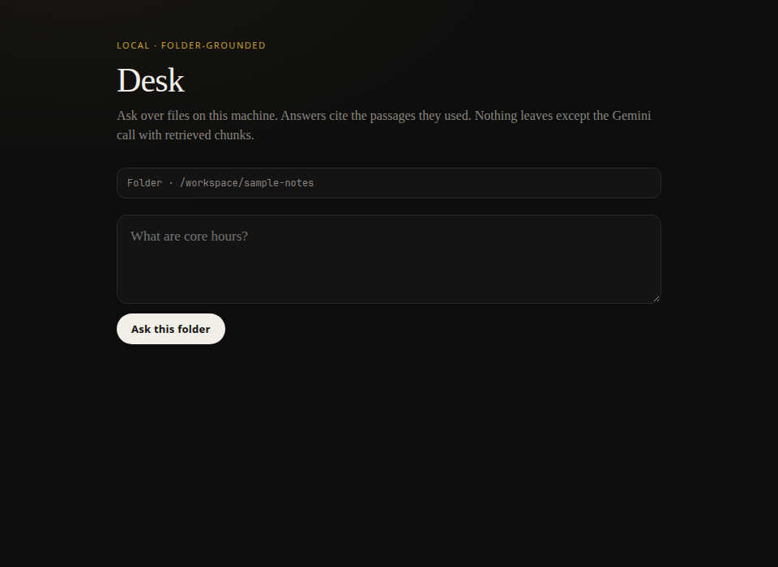

# Desk

**Local-first AI over a folder of notes.** Point Desk at docs on disk, ask a question, get an answer grounded in those files — then optionally write a report back into the folder.

A useful local/agentic desktop workflow, not another cloud chat and not a research paper.



```
folder of notes  →  retrieve passages  →  Gemini  →  cited answer
                                         ↘ optional REPORT.md
```

## 60-second run

```bash
git clone https://github.com/jakob-alexander2000/desk.git
cd desk
npm install
export GEMINI_API_KEY=your_key_here   # free Gemini key is enough
npm run desk -- ask ./sample-notes "What is our Q4 hiring priority?"
```

Expected shape (wording varies by model):

```
Our Q4 hiring priority is **applied AI / agent tooling** …
Sources:
  [1] hiring.md:…
```

Local UI (this machine only):

```bash
npm run desk -- ui ./sample-notes
# → http://127.0.0.1:3847
```

Write a report back into the folder:

```bash
npm run desk -- report ./sample-notes \
  -q "Summarize hiring decisions and open questions" \
  -o ./sample-notes/REPORT.md
```

## Why this exists

Hiring managers can click [CiteBot](https://citebot-chi.vercel.app) (cloud RAG + verify harness) and [citebot-evals](https://github.com/jakob-alexander2000/citebot-evals). Desk is the third bet: **the same grounding idea, but the corpus is your machine.**

## Commands

| Command | What it does |
|---------|----------------|
| `desk ask <folder> "<q>"` | Grounded answer + source list |
| `desk ask … --write-report <path>` | Same, plus write markdown report |
| `desk report <folder> -q "…" -o out.md` | Summarize / answer → file |
| `desk ui <folder> [--port 3847]` | Localhost UI bound to `127.0.0.1` |

## Demo GIF note

`docs/demo.gif` shows the localhost UI path: empty → typed question → answer with citations from `./sample-notes`. The answer text is from a successful live `desk ask` against Gemini. A second live UI capture in the same session hit Gemini free-tier **429** (daily request quota); the GIF therefore uses real UI chrome + that proven CLI transcript rather than a second live model call.

## Verify

```bash
npm install
npm run typecheck
# live smoke (needs GEMINI_API_KEY; may 429 on free tier):
npm run desk -- ask ./sample-notes "What is our Q4 hiring priority?" --write-report ./sample-notes/REPORT.md
test -f ./sample-notes/REPORT.md && echo "report ok"
```

## Feature map

See [FEATURE_MAP.md](./FEATURE_MAP.md).

## Stack

- TypeScript / Node 20
- `@google/generative-ai`
- Keyword retrieve over local chunks (no vector DB in v0.1)
- Tiny built-in HTTP UI (no Electron/Tauri packaging)

## What’s proven vs not

| Proven (Linux) | Not proven / killed for v0.1 |
|----------------|------------------------------|
| CLI ask + report writeback | Electron / Tauri installers |
| Localhost UI on `127.0.0.1` | macOS `.dmg` / Windows installer |
| Grounding on `./sample-notes` | Ollama offline path |
| Typecheck + live Gemini smoke | App Store / code signing |

## Privacy note

File bytes stay on disk for scan/retrieve. **Retrieved chunks + your question** are sent to Gemini when you ask. The UI listens on localhost only.

## License

MIT © Jakob Alex
